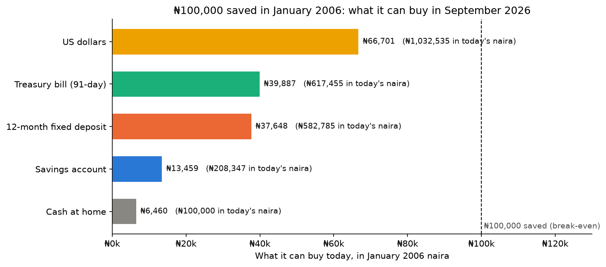
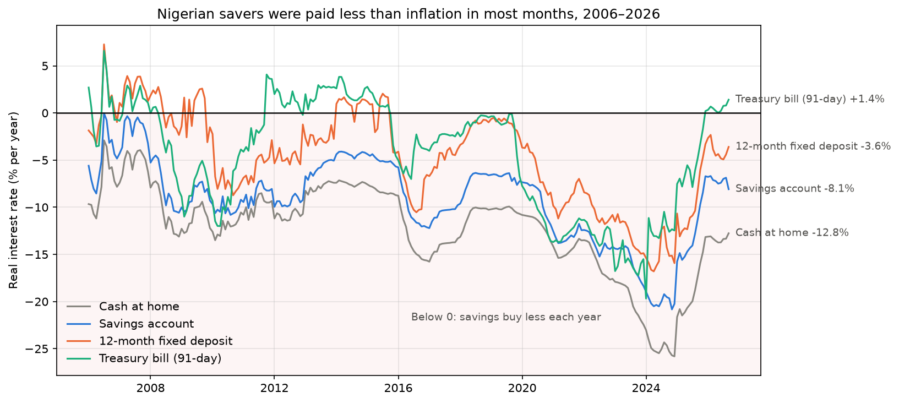
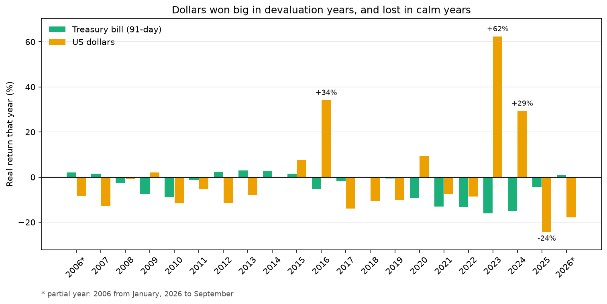
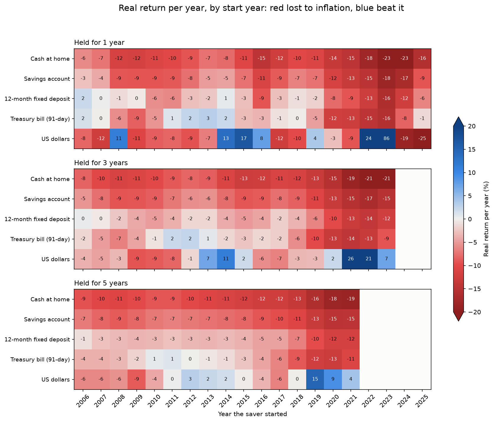
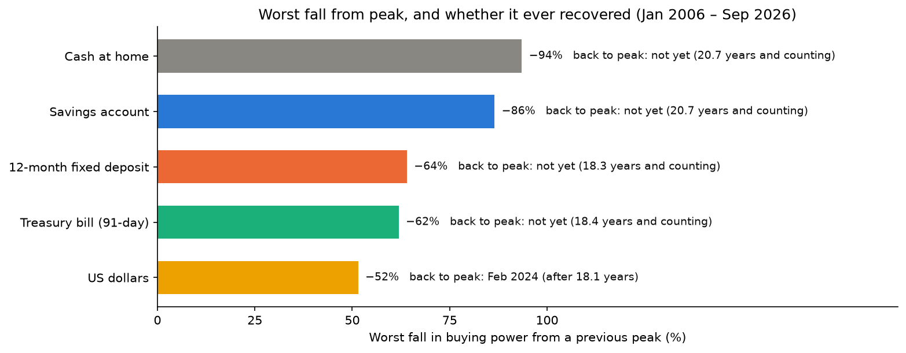
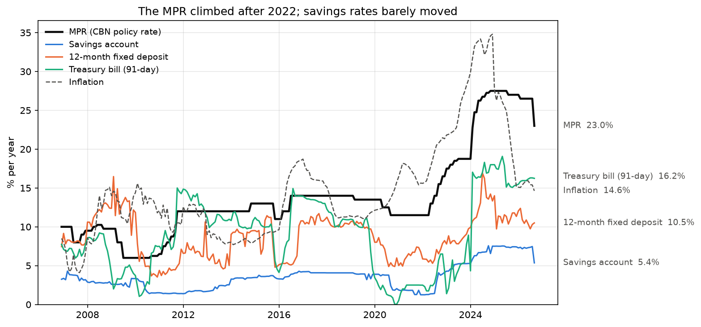
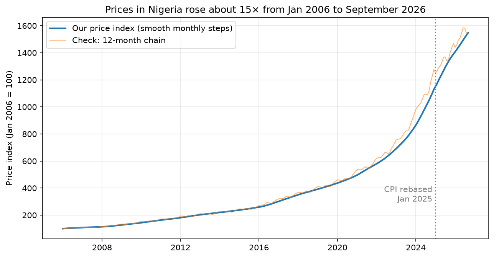

# Did Your Savings Beat Inflation? Nigeria, 2006–2026

Nigerians save in bank accounts, fixed deposits, Treasury bills or US dollars. Between 2006
and 2026, inflation often ran far above the interest banks paid: savings accounts paid around
5% while inflation reached 34.8% in 2024. Money in the bank grew in naira while buying less
and less.

This project measures how each common way of saving performed **after inflation**, using
monthly data from the Central Bank of Nigeria (CBN): which options protected savers, when,
and for how long.

> **This is analysis of past data, not financial advice.** Past returns don't predict future
> returns.



## Key findings

**No common way of saving kept its buying power from January 2006 to September 2026.**
Prices rose about 15.5×, so you'd need about ₦1.55 million today to buy what ₦100,000 bought in 2006.

| ₦100,000 saved in Jan 2006 | Worth in naira (Sep 2026) | **What it can buy, in 2006 naira** | Real return per year |
|---|---|---|---|
| US dollars (cash) | ₦1,032,535 | **₦66,701** | −1.9% |
| Treasury bills (91-day) | ₦617,455 | **₦39,887** | −4.3% |
| 12-month fixed deposit | ₦582,785 | **₦37,648** | −4.6% |
| Savings account | ₦208,347 | **₦13,459** | −9.2% |
| Cash at home | ₦100,000 | **₦6,460** | −12.4% |

1. **Savings paid less than inflation almost all the time.** Savings accounts had a negative
   real interest rate in **every one of 249 months**. Fixed deposits lost to inflation in 81% of
   months and Treasury bills in 70%. Both began a losing stretch in October 2015 that lasted
   about 10 years for T-bills and is still going for fixed deposits.

   

2. **Dollars lost the least, but in bursts and with far more risk.** Dollars beat Treasury bills in
   only 9 of 21 years. Nearly all their gains came in devaluation years (+34% real in 2016, +62%
   in 2023, +29% in 2024). In calm years they lost almost the full inflation rate. They were about
   **10× bumpier** than naira deposits.

   

3. **Timing mattered, but no start month rescued a savings account.** Testing every start month
   with 1-, 3- and 5-year holds: savings accounts and cash never beat inflation. Fixed deposits beat
   it in only 1 of 189 five-year windows. Dollars beat it in 47% of five-year windows, but their
   one-year results ranged from −31% to +160% depending only on the start month.

   

4. **The naira options never recovered.** Measured in buying power, cash fell 93.5% and savings
   accounts 86.5% from their January 2006 starting point. Fixed deposits and T-bills peaked in 2008
   and are still about 62–64% below that peak, 18 years later. Dollars fell 52%, took 18 years
   to recover (Feb 2024), and have since fallen 50% again.

   

5. **CBN rate hikes didn't rescue savers.** When the policy rate (MPR) rose 1 point, savings
   account rates rose only about 0.25 points. In September 2026 the MPR was 23% and savings
   accounts paid 5.4%. Real returns were actually *lowest* during hiking periods, because the
   CBN raised rates after inflation had already climbed.

   

6. **Tax makes it a little worse.** With Nigeria's 10% withholding tax on interest, fixed deposits
   keep about ₦31,800 of 2006 buying power instead of ₦37,600. The small positive real return on
   Treasury bills since December 2025 turns slightly negative after tax.

More charts are in [`images/`](images/), and every step is explained in the notebook.

## How it works

| Option | Rate used (CBN field) | How it grows |
|---|---|---|
| Cash at home | none | Doesn't grow: the "do nothing" baseline |
| Savings account | `savingsDeposit` | Interest added monthly at rate ÷ 12 |
| 12-month fixed deposit | `twelveMonthsDeposit` | Rate locked for 12 months, then rolled over |
| Treasury bills | `treasuryBill` (the **91-day** bill) | Rate locked for 3 months, then rolled over |
| US dollars (cash) | Official USD/NGN rate | No interest; gains only when the naira falls |

- **Real interest rate (Fisher):** `(1 + rate) / (1 + inflation) − 1`
- **Real value:** naira value ÷ price index × the index at the start (Jan 2006 = 100)
- **Annualised return (CAGR):** `(end / start) ** (1 / years) − 1`
- **Drawdown:** the fall from the highest real value so far
- **Rolling windows:** every start month, held for 1, 3 and 5 years

## Assumptions and limitations

- **Approximate price index.** The CBN publishes inflation **rates** but no index feed, so the price
  index is built by turning each year-on-year rate into a monthly step, `(1 + yoy) ** (1/12) − 1`,
  and chaining them. It runs straight across the **January 2025 CPI rebasing** (chain-linked, not
  restarted). A second method agrees on the 2006–2026 total within about 0.2%, but mid-period values
  can differ by up to about 13%.

  

- **2025 inflation revision.** The National Bureau of Statistics (NBS) rebasing in January 2025 used
  December 2023 – November 2024 as its base period while labelling it "2024 = 100". On 15 January 2026,
  NBS published a corrected series that raised every 2025 year-on-year rate by about 3 points (e.g.
  November 2025: 14.45% first released, 17.33% revised). The CBN feed holds the **revised** figures,
  which this project uses. News reports from 2025 quote the lower first releases.
- **Official exchange rate only.** Before the June 2023 unification, many savers could only buy
  dollars on the parallel market at a weaker rate, and the official rate was often held flat for
  years. Dollar returns may be **understated**.
- **Simplified products.** CBN average rates, not any one bank's. No fees. Fixed deposits and T-bills
  earn exactly the rate locked at each rollover.
- **Tax.** The main results are before tax. The tax extension uses best-estimate start dates for the
  10% withholding tax: long-standing on fixed deposits, from January 2026 on savings accounts, and
  from November 2025 on Treasury bills (after a 2011 exemption lapsed). It also shows a "10% every
  year" upper bound.
- **Data fixes.** Fake zeros were treated as missing: the MPR before it existed (2006), and two
  Treasury bill months (Dec 2017 and Dec 2018, filled with the previous month's rate). June 2025
  inflation, an exact copy of May in the feed, was interpolated between May and July.
- **Patterns, not causes.** The policy section shows what happened together, not proof of cause and effect.

## Data sources

The data comes from **undocumented JSON feeds** behind the CBN's data pages. They are not an
official API and could change or disappear, so the notebook saves a CSV snapshot
(`data/cbn_savings_data.csv`) on every successful pull and falls back to it when offline.

| Feed | Content |
|---|---|
| `https://www.cbn.gov.ng/api/GetAllMoneyMarketIndicators` | Monthly deposit, T-bill and policy rates, Jan 2006 onwards |
| `https://www.cbn.gov.ng/api/GetAllInflationRates` | Monthly year-on-year inflation, Jan 2003 onwards |
| `https://www.cbn.gov.ng/api/GetAllExchangeRates` | Daily official exchange rates (averaged to monthly) |

Other sources:
- The January 2026 NBS revision of 2025 inflation:
  [The NBS Backtracks (Stops and Gaps)](https://stopsandgaps.substack.com/p/the-nbs-backtracks),
  [Arise: Teriba on the NBS inflation revision](https://www.arise.tv/teriba-nbs-inflation-revision-arbitrary-and-senseless-lacks-global-precedent),
  [Vanguard: LCCI backs the revised CPI methodology](https://www.vanguardngr.com/2026/01/december-inflation-lcci-backs-nbs-on-revised-cpi-methodology/amp/)
- MPR introduction in Dec 2006: [CBN monetary policy decisions, 2006](https://www.cbn.gov.ng/monetarypolicy/decisions/2006.asp)
- Withholding tax:
  [SEC circular on the 2011 exemption order expiring](https://sec.gov.ng/circular-on-the-expiration-of-the-companies-income-tax-exemption-of-bonds-and-short-term-government-securities-order-2011),
  [BusinessDay on T-bill tax](https://businessday.ng/banking/article/banks-begin-charging-taxes-on-bonds-t-bills-as-exemption-expires/),
  [Legal500 on the FIRS directive](https://www.legal500.com/intelligence/nigeria/tax/firs-imposes-10-withholding-tax-on-interest-on-short-term-securities),
  [BusinessDay on savings interest](https://businessday.ng/?p=1090131),
  [Nairametrics fixed deposit guide](https://nairametrics.com/guide-making-money-investing-nigerian-fixed-deposits/)

## How to run

Requires Python 3.12 or newer. On Windows:

```powershell
git clone https://github.com/Freedom15dev/nigeria-savings-vs-inflation.git
cd nigeria-savings-vs-inflation
py -m venv .venv
.venv\Scripts\activate
pip install -r requirements.txt
```

On macOS or Linux, use `python3 -m venv .venv` and `source .venv/bin/activate` instead.

Then open `savings_vs_inflation.ipynb` in VS Code or Jupyter, select the `.venv` kernel and
**Run All**. The notebook downloads fresh data from the CBN; if that fails, it uses the saved
snapshot in `data/`.

## Project structure

```
nigeria-savings-vs-inflation/
├── README.md
├── requirements.txt
├── savings_vs_inflation.ipynb   # the full analysis, explained step by step
├── data/
│   └── cbn_savings_data.csv     # snapshot of the CBN data pull
└── images/                      # charts used in this README
```

## Related projects

- [weather-analysis](https://github.com/Freedom15dev/weather-analysis): exploratory data analysis with pandas and matplotlib
- [nigeria-inflation-forecast](https://github.com/Freedom15dev/nigeria-inflation-forecast): forecasting Nigerian inflation from the same CBN feeds
